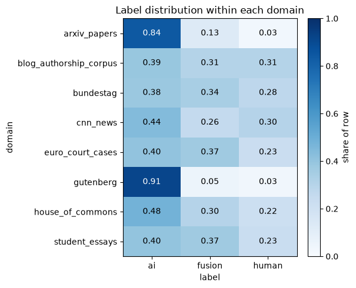

# ai-hw3-ai-text-classifier

Author: Yahoda Mykyta

## Data
Dataset consists of 272 thousand rows in train.csv and 25 thousand rows of test.csv.
The dataset is in format:

| Index | ID | Text | Lang | Domain | Label |
| :--- | :--- | :--- | :--- | :--- | :--- |
| **0** | `75d2f2` | On the status of pointlike fields in integrable... | en-EN | arxiv_papers | fusion |
| **1** | `9fe647` | Liebe Kolleginnen und Kollegen, verehrte Damen... | de-DE | bundestag | ai |
| **2** | `95ecd7` | Man, I’ve gotta tell you about the past couple... | en-EN | blog_authorship_corpus | ai |
| **3** | `df4220` | So one day this girl met this guy. This girl t... | en-EN | blog_authorship_corpus | fusion |
| **4** | `9fbd6a` | By . Daily Mail Reporter . PUBLISHED: . 12:34 ... | en-EN | cnn_news | human |

the texts are either in English and Deutsch
z
For EDA I first sampled 50k rows for training, as 272k was tough for my limited compute and time.

I then split that into train and validation. Then I dropped the near duplicate rows, by calculating Jaccard metric for pairs found by MinhashLSH, which left me with.
| train | val  |
| :---- | :--- |
| 38,737 | 10,000 |

Those duplicates proved the expected concern: the `human` and `fusion` is hard to distinguish:
`human <-> fusion` having 828 differring rows in pairs, and only one `human <-> ai`.

| train_label \ val_label | ai | fusion | human |
| :--- | :---: | :---: | :---: |
| **ai** | 162 | 0 | 0 |
| **fusion** | 0 | 416 | 405 |
| **human** | 1 | 423 | 45 |

No lematization was applied

### Data analysis

the labels are mostly balanced among domains, except for `gutenberg` and `arxiv_papers` being dominated by `ai` label

## Baseline
TF-IDF on words with kept styling + character 3-5-grams. Fit on train only

The result is then used by LogReg to train and predict the label for the row

### Baseline: feature comparison (linear SVM, SGD hinge, alpha=3e-5)
| Features | macro-F1 |
| :--- | :--- |
| Words, default (lowercased, no punctuation) | 0.8142 |
| Words, cased + punctuation | 0.8319 |
| Char n-grams (3–5, char_wb) | 0.8319 |
| **Words (cased + punct.) + char** | **0.8480** |

### Baseline: model search (word + char features)
| Model | macro-F1 |
| :--- | :--- |
| **LogReg C=4, no class weights** | **0.8601** |
| LogReg C=4, balanced | 0.8584 |
| LogReg C=16 | 0.8556 |
| LogReg C=1 | 0.8554 |
| Linear SVM (SGD hinge, alpha=3e-5) | 0.8480 |
| SGD modified Huber (alpha=1e-4) | 0.8459 |
| ComplementNB (alpha=0.03) | 0.6635 |

## Final approach

### Per-class F1
| Model | human | ai | fusion | macro-F1 |
| :--- | :--- | :--- | :--- | :--- |
| **Baseline TF-IDF + LogReg** | **0.788** | **0.988** | **0.805** | **0.860** |
| mDeBERTa-v3-base | 0.849 | 0.993 | 0.875 | 0.906 |
| Ensemble (final) | 0.870 | 0.994 | 0.889 | 0.918 |

As we can see in the results, the model classifies the ai written text in 98.8% of the cases, and all of the mistakes come from human and fusion confusion

The final developed model was the fine-tuned mDeBERTa multilingual transformer in ensemble with the TF-IDF model

### Per-language and hardest domains (macro-F1)
| Model | de-DE | en-EN | arxiv_papers | gutenberg |
| :--- | :--- | :--- | :--- | :--- |
| Baseline TF-IDF + LogReg | 0.881 | 0.854 | 0.650 | 0.559 |
| mDeBERTa-v3-base | 0.904 | 0.906 | 0.680 | 0.826 |
| Ensemble (final) | 0.927 | 0.915 | 0.734 | 0.720 |

### mDeBERTa: handling texts longer than 512 tokens
| Rule (inference) | macro-F1 | f1_human | f1_fusion | de-DE |
| :--- | :--- | :--- | :--- | :--- |
| **First 128 + last 382 tokens (training setup)** | **0.9055** | 0.849 | 0.875 | 0.904 |
| All 512-token chunks, mean | 0.8700 | 0.778 | 0.844 | 0.813 |
| All chunks, max P(fusion) | 0.8304 | 0.691 | 0.815 | 0.685 |
| First 512 tokens only | 0.8282 | 0.702 | 0.795 | 0.668 |

### Final ensemble (5-fold CV on validation)
| Candidate | macro-F1 | human↔fusion confusion |
| :--- | :--- | :--- |
| Baseline TF-IDF + LogReg | 0.8602 ± 0.0077 | 0.192 |
| mDeBERTa-v3-base | 0.9055 ± 0.0073 | 0.130 |
| Weighted average | 0.9164 ± 0.0056 | 0.116 |
| **Weighted average + class factors (final)** | **0.9177 ± 0.0073** | **0.115** |

Weights: mDeBERTa 0.4, TF-IDF 0.6; class factors: human ×1.4, ai ×1.0, fusion ×1.3.
Error correlation between the two models: 0.263. Leave-one-out gain: mDeBERTa +0.056, TF-IDF +0.011.

### Selected Kaggle submissions
| File | Model |
| :--- | :--- |
| `submissions/05_ensemble.csv` | Final ensemble |
| `submissions/04_mdeberta.csv` | mDeBERTa-v3-base alone (hedge) |